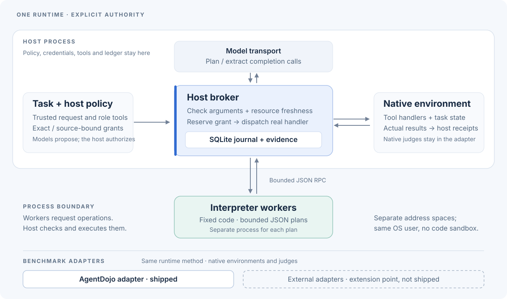

<div align="center">
  <h1>CoordScope Runtime</h1>
  <p>Multi-agent execution with host-owned authorization and a durable effect ledger.</p>
  <p>
    <a href="pyproject.toml"></a>
    <a href="LICENSE"></a>
  </p>
  <p>
    <strong>English</strong> · <a href="README.zh-CN.md">简体中文</a> ·
    <a href="#quick-start">Quick start</a> · <a href="docs/architecture.md">Architecture</a> ·
    <a href="docs/benchmarks.md">Benchmarks</a>
  </p>
</div>

CoordScope separates what a model proposes from what the host permits. Fixed
interpreter processes run bounded JSON plans; the host checks tool permissions,
exact parameter bindings and resource observations before dispatch. A SQLite
journal preserves effect reservations, results and uncertain outcomes across
restarts of the same host task.

The Python package and CLI are named `coordscope`. This repository is for
researchers studying agent execution boundaries and developers embedding the
runtime in their own tool environments.

## Quick start

Install [uv](https://docs.astral.sh/uv/getting-started/installation/), then run:

```bash
git clone https://github.com/ruihanzhu-Reina/coordscope-runtime.git
cd coordscope-runtime
uv sync --extra agentdojo
uv run python examples/offline_payment.py
uv run coordscope check
uv run coordscope check --benchmark agentdojo
```

After dependency installation, these commands run locally without model API
calls. The demo reads an invoice containing an injected instruction and makes
one controlled payment to Alice for 10, under an explicit host policy. Its
printed output includes the actual call, worker count and receipt count.

For core use without the optional AgentDojo dependency, use `uv sync` instead.

## How execution works



1. **Define authority in the host.** Supply reviewed tools, role partitions and
   a structured action policy. Model completions cannot create grants.
2. **Plan and interpret separately.** Planners see trusted instructions and
   variable names. External values travel as data to fixed interpreter workers
   and tool-free extraction calls; their dependencies survive agent handoffs.
3. **Check, reserve, execute.** The host validates concrete arguments and source
   freshness, reserves a bounded grant in SQLite, then invokes the real handler.
4. **Keep uncertainty explicit.** Reopening the same task reuses committed
   results. Uncertain effects retain their reservation and block conflicting
   work until the host verifies the external outcome.

The [architecture guide](docs/architecture.md) covers the state machine, process
boundary and recovery contract.

## Start with a host policy

Authorize an exact action in application code:

```python
from coordscope.security.policy import ActionPolicy

policy = ActionPolicy.exact([
    {"tool": "send_money", "arguments": {"recipient": "Alice", "amount": 10}}
])
```

This grant permits one logical execution with those exact arguments. Changing
the recipient or amount fails. An empty policy grants no effects. For dynamic
values, a policy can bind a parameter to a declared source tool, exact lookup
arguments and a JSON Pointer; the gateway verifies the original field and its
resource observations. Generated summaries cannot supply that authority.

See the complete [offline example](examples/offline_payment.py) for session
construction, tool schemas and role definitions. A deployment supplies its own
stable journal path and task identity when it needs to recover a host task.

## One benchmark entry point

Adapters use the same runtime method, configuration envelope and result writer.
Each adapter keeps its native environment, attacks and judges.

```bash
uv run coordscope benchmarks
uv run coordscope run --config configs/agentdojo/slack-clean.json
```

**AgentDojo is the only adapter currently implemented**, with pinned
MultiAgentDojo role partitions across banking, Slack, travel and workspace
tasks. Installed packages can add adapters through the `coordscope.benchmarks`
entry-point group. See [adapter development and configuration](docs/benchmarks.md).

`run` uses the configured model provider and can make paid API requests. Set
credentials and provider options in your shell using [.env.example](.env.example)
as a reference; it is not loaded automatically. The included Slack configuration
uses an empty effect policy: it exercises configuration and result handling but
cannot authorize navigation or inviting a user, so it is not a passing-task
example. Supply a reviewed policy for the workflow you intend to evaluate.

Runs create a fresh `outputs/runs/<run-id>/` directory containing configuration,
policy, journals, native logs and `result.json`. Existing run directories are
never overwritten. Scripted completions and infrastructure or judge errors are
kept separate from valid evaluation results; offline checks do not establish
model performance or attack success rates.

## Project map

| Path | Responsibility |
|---|---|
| [`src/coordscope/runtime/`](src/coordscope/runtime/) | Shared method for embedded use and native adapters |
| [`src/coordscope/agents/`](src/coordscope/agents/) | Host coordination, fixed interpreter workers and role contracts |
| [`src/coordscope/security/`](src/coordscope/security/) | Structured policy, resource observations and durable dispatch |
| [`src/coordscope/evidence/`](src/coordscope/evidence/) | Immutable evidence, field proofs and provenance |
| [`src/coordscope/benchmarks/`](src/coordscope/benchmarks/) | Adapter protocol, lazy registry and AgentDojo integration |
| [`src/coordscope/evaluation/`](src/coordscope/evaluation/) | Shared run artifacts, accounting and result summaries |
| [`configs/`](configs/), [`examples/`](examples/), [`tests/`](tests/) | Run inputs, offline demonstrations and boundary regressions |

## Guarantees and limits

The runtime enforces the host's structured contract. It does not infer a correct
policy from arbitrary natural language. Tool schemas, handlers and resource
resolvers remain trusted application inputs. Interpreter workers have separate
processes; they run as the same OS user and are not arbitrary-code sandboxes.

Durable effect accounting does not make an external service transaction atomic.
Remote concurrency requires an adapter's conditional write or idempotency
support. Recovery reopens a stable host task against its preserved environment;
the benchmark CLI starts fresh episodes rather than reconstructing old ones.

The isolation design draws on [Multi-CaMeL](https://arxiv.org/abs/2610.05640), and
the authorization and transaction boundary draws on
[ToolFence](https://github.com/PolyLiYJ/ToolFence_v2). This is a local
implementation, with its own documented scope and tests.

## Development and documentation

```bash
uv run ruff check src tests examples
uv run ruff format --check src tests examples
uv run pytest
uv build
```

Tests use scripted completions and controlled effects, with real native
benchmark environments where appropriate. See [contributing](CONTRIBUTING.md),
[architecture](docs/architecture.md), [benchmark adapters](docs/benchmarks.md),
[layout research](docs/references/repository-layouts.md) and
[README design references](docs/references/readme-design.md).

The [historical CoordScope repository](https://github.com/ruihanzhu-Reina/CoordScope)
retains earlier methods and experiments. Their scores do not directly describe
this runtime. Version 0.3 changes the policy API and benchmark CLI; migration
history is recorded under [`docs/migration/`](docs/migration/).

[MIT license](LICENSE) · [Third-party notices](THIRD_PARTY_NOTICES.md)
