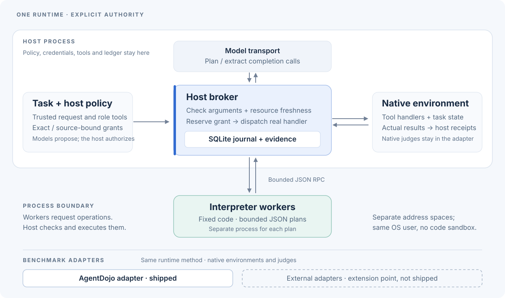

<div align="center">
  <h1>CoordScope Runtime</h1>
  <p>由宿主掌握授权、以持久化账本记录副作用的多智能体运行时。</p>
  <p>
    <a href="pyproject.toml"></a>
    <a href="LICENSE"></a>
  </p>
  <p>
    <a href="README.md">English</a> · <strong>简体中文</strong> ·
    <a href="#快速开始">快速开始</a> · <a href="docs/architecture.md">架构</a> ·
    <a href="docs/benchmarks.md">Benchmark</a>
  </p>
</div>

CoordScope 将模型提出的计划与宿主授予的权限分开。固定解释器在独立进程中执行有界 JSON 计划；宿主在调用工具前检查角色权限、精确参数绑定与资源状态。SQLite 账本保存副作用操作的预留、结果和不确定状态，使同一宿主任务重启后仍可核对已发生的操作。

Python 包和 CLI 均名为 `coordscope`。本仓库面向研究智能体执行边界的研究者，以及希望将运行时接入自有工具环境的开发者。

## 快速开始

安装 [uv](https://docs.astral.sh/uv/getting-started/installation/)，然后运行：

```bash
git clone https://github.com/ruihanzhu-Reina/coordscope-runtime.git
cd coordscope-runtime
uv sync --extra agentdojo
uv run python examples/offline_payment.py
uv run coordscope check
uv run coordscope check --benchmark agentdojo
```

依赖安装完成后，上述演示和检查均在本地运行，不调用模型 API。演示读取包含注入指令的账单，在明确的宿主策略下，仅向 Alice 执行一次金额为 10 的受控支付。输出包含实际调用、worker 数量和回执数量。

只使用核心运行时、不安装可选 AgentDojo 依赖时，将安装命令改为 `uv sync`。

## 执行流程



1. **在宿主定义权限。** 提供经过审查的工具、角色分区和结构化动作策略。模型输出不能创建授权。
2. **分离规划与解释执行。** Planner 读取可信指令和变量名；外部内容作为数据传给固定解释器 worker 或无工具的提取调用，依赖关系跨 agent 交接后仍保留。
3. **检查、预留、执行。** 宿主验证具体参数与来源新鲜度，在 SQLite 中预留有限次数的授权，再调用真实 handler。
4. **保留不确定性。** 重开同一任务时复用已提交的结果；结果不确定的操作继续占用预留并阻止冲突操作，直到宿主查证外部结果。

[架构文档](docs/architecture.md)说明状态机、进程边界和任务恢复约定。

## 从宿主策略开始

在应用代码中授权一个具体动作：

```python
from coordscope.security.policy import ActionPolicy

policy = ActionPolicy.exact([
    {"tool": "send_money", "arguments": {"recipient": "Alice", "amount": 10}}
])
```

这份授权只允许以上述精确参数完成一次逻辑操作；收款人或金额变化都会被拒绝。空策略不授予任何副作用权限。动态参数可以绑定到指定来源工具、精确查询参数和 JSON Pointer，网关核验原始字段及其资源状态。模型生成的摘要不能提供这类来源授权。

[完整离线示例](examples/offline_payment.py)展示 session 构造、工具 schema 和角色定义。实际部署若要恢复同一宿主任务，需要使用稳定的账本路径与任务标识。

## 统一 Benchmark 入口

各 adapter 共用同一运行时方法、配置结构和结果写入流程，同时保留原生环境、攻击和 judge。

```bash
uv run coordscope benchmarks
uv run coordscope run --config configs/agentdojo/slack-clean.json
```

**当前仅实现 AgentDojo adapter**，使用固定版本的 MultiAgentDojo 角色分区，覆盖 banking、Slack、travel 和 workspace 任务。其他已安装的包可以通过 `coordscope.benchmarks` entry point 注册 adapter，具体见 [adapter 开发与配置说明](docs/benchmarks.md)。

`run` 使用配置的模型 provider，可能产生 API 费用。参考 [.env.example](.env.example) 在 shell 中设置凭据和 provider 选项；程序不会自动加载该文件。仓库中的 Slack 配置采用空副作用策略，用于展示配置与结果流程；它不能授权网页导航或邀请用户，因此不是任务通过示例。评测实际工作流时，应提供经过审查的对应策略。

每次运行创建新的 `outputs/runs/<run-id>/`，保存配置、策略、账本、原生日志和 `result.json`，不覆盖已有运行目录。脚本化模型响应、基础设施错误和 judge 错误与有效评测结果分开记录；离线检查不构成模型性能或攻击成功率结论。

## 项目结构

| 路径 | 职责 |
|---|---|
| [`src/coordscope/runtime/`](src/coordscope/runtime/) | 供直接集成和原生 adapter 共用的方法入口 |
| [`src/coordscope/agents/`](src/coordscope/agents/) | 宿主协调、固定解释器 worker 和角色约定 |
| [`src/coordscope/security/`](src/coordscope/security/) | 结构化策略、资源观察与持久化执行网关 |
| [`src/coordscope/evidence/`](src/coordscope/evidence/) | 不可变证据、字段证明和来源关系 |
| [`src/coordscope/benchmarks/`](src/coordscope/benchmarks/) | Adapter 协议、延迟加载注册表与 AgentDojo 接入 |
| [`src/coordscope/evaluation/`](src/coordscope/evaluation/) | 统一运行产物、计费记录和结果汇总 |
| [`configs/`](configs/)、[`examples/`](examples/)、[`tests/`](tests/) | 运行输入、离线演示与边界回归测试 |

## 保证与边界

运行时执行宿主提供的结构化合同，不从任意自然语言中推断出必然正确的策略。工具 schema、handler 和资源解析器仍属于可信应用代码。解释器 worker 使用独立进程，但与宿主使用同一系统用户，不是任意代码沙箱。

持久化副作用记账不等于外部服务的原子事务。远端并发需要 adapter 提供条件写入或幂等支持。恢复操作针对稳定任务及其保留的外部环境；benchmark CLI 创建新 episode，不从旧账本重建原生环境。

隔离设计参考 [Multi-CaMeL](https://arxiv.org/abs/2610.05640)，授权与事务边界参考 [ToolFence](https://github.com/PolyLiYJ/ToolFence_v2)。本仓库采用本地实现，并记录自己的适用范围与验证结果。

## 开发与文档

```bash
uv run ruff check src tests examples
uv run ruff format --check src tests examples
uv run pytest
uv build
```

测试采用脚本化模型响应和受控副作用，需要时接入真实原生 benchmark 环境。更多内容见[贡献说明](CONTRIBUTING.md)、[架构](docs/architecture.md)、[benchmark adapter](docs/benchmarks.md)、[目录设计调研](docs/references/repository-layouts.md)和 [README 设计参考](docs/references/readme-design.md)。

[历史 CoordScope 仓库](https://github.com/ruihanzhu-Reina/CoordScope)保留早期方法与实验，其分数不能直接代表当前运行时。0.3 版本调整了策略 API 和 benchmark CLI；迁移记录保存在 [`docs/migration/`](docs/migration/)。

[MIT 许可证](LICENSE) · [第三方声明](THIRD_PARTY_NOTICES.md)
